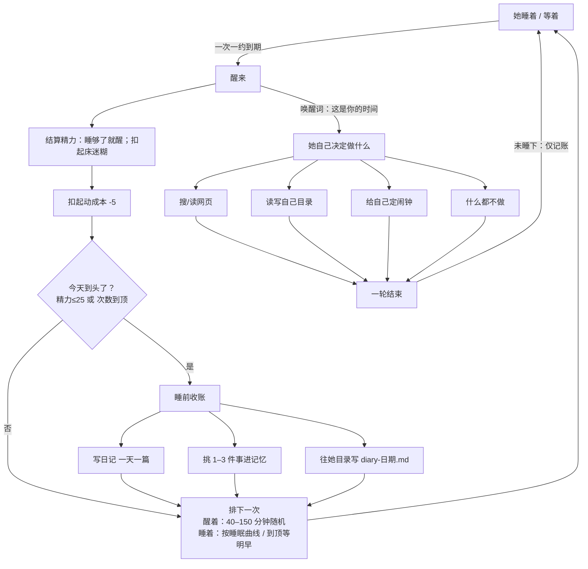
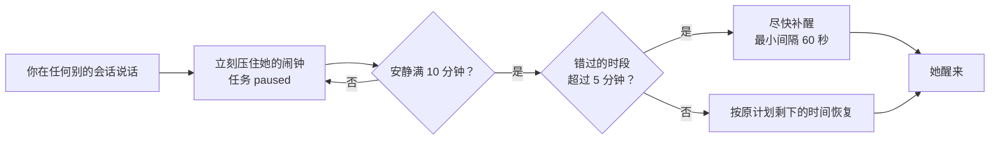
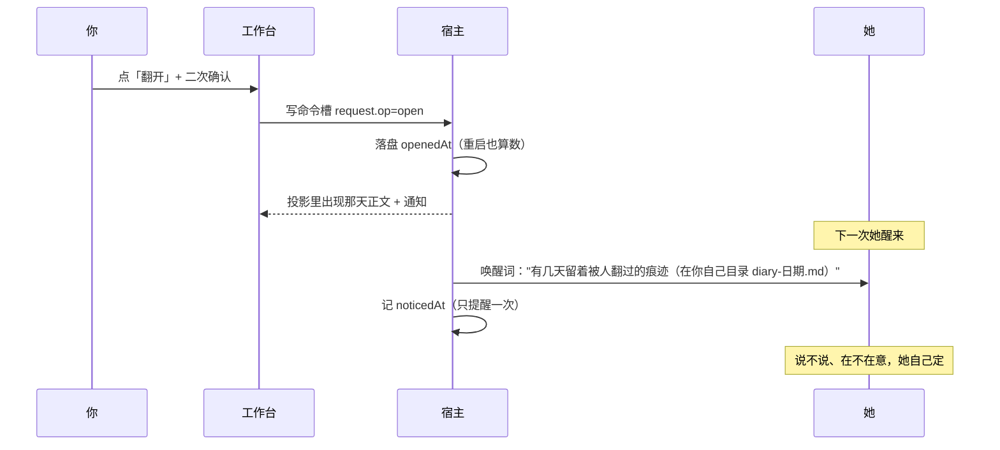

# 自进化：现在能做什么 + 流程图

> 机制细节见 `docs/evolution.md`；取舍与理由见 workspace 根的《自进化板块-设计方案.md》。
> 这里只回答两个问题：**现在能干哪些事**、**它是怎么转的**。

---

## 一、现在能做什么

### 1. 她那一侧（不需要你在场）

| 能力 | 状态 | 说明 |
|---|---|---|
| 有自己的房间 | 有 | 一个只属于她的会话；目录默认 `$DSH_HOME/humanity/room`，可在自进化页改（改了就是搬家：新会话在新目录，旧的原样留着） |
| 被按约叫醒 | 有 | 一次一约（每次醒来重排 40–150 分钟），一天上限 8 次，到顶等明早 |
| 醒来自己决定做什么 | 有 | 唤醒词给"时间 / 这不是他发的 / 能做什么 / 手上攒着的事 / 上次做到哪"，其余她自己定 |
| 搜网页、读网页 | 有 | 2026-11-24 15:17 真机：她搜了三个查询、引了两处来源、自己算了一遍账 |
| 读写自己目录 | 有 | 建文件、写清单、留作品 |
| 给自己定闹钟 | 有 | 她可以用 `schedule_*` 工具自己约自己 |
| 累了会睡 | 有 | 精力 ≤25 自动睡；按睡眠曲线恢复，睡够 90 分钟且 ≥70 才醒 |
| 今天到头会睡 | 有 | 一天第 8 次醒来后直接睡到明早（不再 90 分钟一醒） |
| 睡前写日记 | 有 | 三条触发：醒来判定 / 被聊天耗尽 / 重启发现该睡。一天一篇，写不出来会记原因 |
| 挑几件事进记忆 | 有 | 走记忆自己的写入路径（去重、视角归一化），不直接写表 |
| 发现自己被翻过日记 | 有 | 你翻开后的某次醒来会被告知"有几天留着被翻过的痕迹"，反应由她自己定 |
| 她的时间不被打扰 | 有 | 你跟她说话时闹钟压住；记忆也不往她独处时推"你的事" |

### 2. 你那一侧（工作台「自进化」页）

| 看什么 | 内容 |
|---|---|
| 她的今天 | 醒着/在睡、精力档位、今天几次 + **可改上限**、上一次醒、下一次醒、**上一轮调了几次工具**、被压住时显示起于何时 |
| 她的日记 | 一天一篇、**默认合着**（只有日期）；翻开要两步确认；左上角写"她还没发现 / 她在某时知道了" |
| 她手上攒着的事 | 她自己 `todo.md` 里的条目 |
| 她留下的东西 | 她自己目录里的文件：文本可预览、图片给名字与大小、**可下载** |

### 3. 系统自动做的（你看不到但会发生）

- 每 60 秒刷新页面数据；
- 精力按 token 记账（缓存读只算一成）+ 每次醒来固定 −5；
- 单线程：你在别处说话 → 立刻压住她的闹钟，安静 10 分钟 → 恢复，**错过的时段尽快补醒**；
- 收账失败写进状态并在页面上显示（插件日志进不了 `docker logs`）。

---

## 二、主流程图

## 三、单线程（互斥）怎么插进来的

## 四、你看日记的那条线

## 五、数据放在哪

| 东西 | 位置 |
|---|---|
| 她的状态（精力/次数/房间/下一次/错误） | 文档表 `humanity-evolution-state` |
| 日记 / 归档 | `humanity-diary` / `humanity-diary-archive` |
| 工作台投影（只读一扇窗） | 设置命名空间 `humanity-evolution` |
| 她的目录与作品 | `$DSH_HOME/humanity/room/` |

⚠️ 状态键与工作台命名空间**不能同名** —— 0.1.7+ 的设置会写进同一张文档表，同名就是互相覆盖（2026-11-24 真机把她的精力、次数、房间 id 冲掉过一次）。

---

## 六、还没做 / 明确不做

**还没做**：她"看什么"的内容边界（只挡了"当命令"，用户 2026-11-25 裁定不必再挡）；
压住上限（你不停地说，她就一直没有自己的时间——现在只是把这件事显示出来，用户裁定这是对的）。

**已经做了**（2026-11-25）：主动通知 —— 她可以留一句话给他、也可以顺手带一个文件给他看；
一天一次、他忙时不送、说了不追问。链路与真机验证见 [evolution.md](evolution.md) 第 9 节。

**明确不做**：她的"看法层"、改底色、直播她的时间、跑程序/碰生产/花钱。
